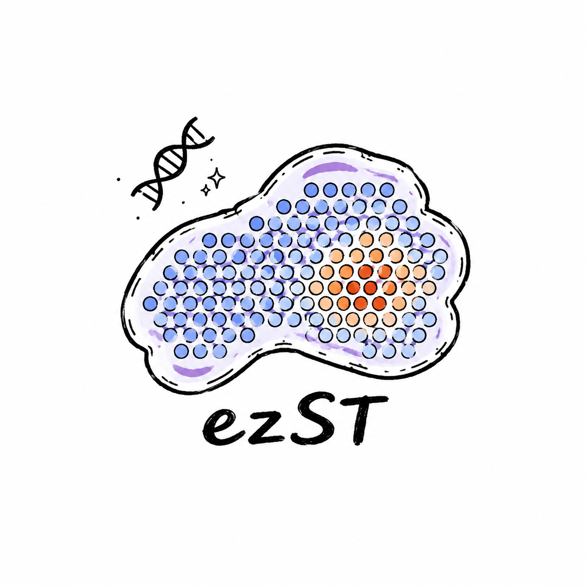
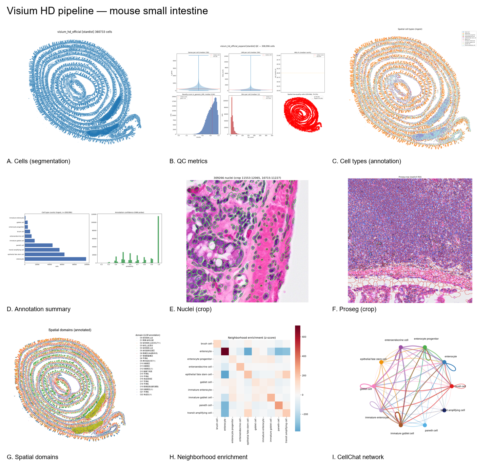

# ezST

<p align="center">
  
</p>

<p align="center"><b>10x Visium 空间转录组分析技能包</b>（Codex Skills Plugin）——分阶段执行，每阶段由 LLM 解读生物学意义后停下等人审查。</p>


## 这是什么

一个可一键安装的 Codex 技能包（marketplace + plugin），把空间转录组分析做成 **5 个阶段的流水线**：

```
加载+QC → 归一化+聚类 → 空间域+SVG → 反卷积 → 邻域富集+细胞通讯
```

每个阶段执行完会：
1. 产出图片（PNG）和结果文件
2. LLM 用 vision 看图 + 读结果，给出**生物学意义解读**
3. **停下**，等你审查
4. 你选择 `通过` / `调整` / `跳过` 后才进入下一阶段

ezST 自带完整的 Python 运行时（`src/ezst/` 独立包，11 个分析函数），不依赖任何外部项目。

## 安装（一键 pip）

ezST 是标准 Python 包，`pip install` 一条命令装好全部 Python 依赖（scanpy / squidpy / scvi-tools / leidenalg / cell2location）：

```bash
# 直接安装（发布版）
pip install ezST

# 或从 GitHub 安装（最新）
pip install git+https://github.com/QING1105/ezST.git
```

> 需要 Python >= 3.10。建议装进独立虚拟环境（conda/venv）。

### R 依赖（仅 S4 反卷积 / S5 细胞通讯需要）

R 包（Seurat / SPOTlight / CellChat）无法通过 pip 安装，单独一条命令：

```bash
Rscript install/install_r_packages.R
```

> 需要 R >= 4.3；Windows 需 [Rtools](https://cran.r-project.org/bin/windows/Rtools/)（脚本自动检测提示）。

### 安装 skill

### 1. 添加 marketplace

```bash
codex plugin marketplace add QING1105/ezST
```

### 2. 安装 plugin

```bash
codex plugin install spatial-transcriptomics
```

> 如果 plugin 名称冲突，可以用 `--from` 指定市场来源：
> ```bash
> codex plugin install spatial-transcriptomics --from ezST
> ```

### 3. 验证安装

```bash
codex plugin list
# 应该看到 spatial-transcriptomics 已安装

codex plugin marketplace list
# 应该看到 ezST
```

### 本地开发安装（不经过 GitHub）

```bash
codex plugin marketplace add ./path/to/ezST
codex plugin install spatial-transcriptomics --from ezST
```

## 使用

安装后，直接对 Codex 说自然语言，它会自动匹配对应 skill：

```text
# 完整流程（会分 5 阶段，每阶段停下等你审查）
分析我的胃癌 Visium 数据，路径在 /data/gastric/GSE246011/，按分阶段流程跑，每阶段停下来给我审查。

# 单阶段调用
# 加载+QC
帮我加载并质控这个 Visium 数据 /data/gastric/GSE246011/GSM7853983_STAD-G1-count.csv.gz

# 反卷积
用 /data/ref_scRNA.h5ad 作为参考，对我的 Visium 数据 /data/gastric/proj/results/01_loading/sample.h5ad 做细胞类型反卷积

# 细胞通讯
对我的聚类结果 /data/gastric/proj/results/04_clustering/sample_clustered.h5ad 做细胞通讯分析
```

### 审查协议

每阶段结束后，你会看到类似这样的解读，然后选择：

```
【S2 阶段结果】
- 关键数字：1202 spots retained / 8 clusters
- 图片观察：cluster 0-3 形成连续的左上区域，cluster 5-7 分散在右下
- 生物学意义：左上区域可能是肿瘤主体，右下可能是间质区
- 建议：聚类分辨率 1.0 是否合适？

请选择：通过 / 调整 / 跳过
```

- `通过`：进入下一阶段
- `调整`：告诉我改什么参数（如"resolution 调到 0.5"），重跑当前阶段
- `跳过`：不做本阶段，继续下一阶段

## Skills 一览

| Skill | 阶段 | 工具链 | 触发场景 |
|:--|:--|:--|:--|
| `spatial-transcriptomics` | 编排 | 5 阶段协议 + 解读模板 + 审查协议 | 完整流程分析 |
| `spatial-s1-load-qc` | S1 | `init_spatial_project` → `load_visium_data` → `filter_visium_spots` | 加载数据、QC 过滤 |
| `spatial-s2-normalize-cluster` | S2 | `normalize_visium` → `cluster_spatial_data` | 归一化、聚类 |
| `spatial-s3-domains-svg` | S3 | `identify_spatial_domains` → `find_spatially_variable_genes` | 空间域、SVG |
| `spatial-s4-deconvolve` | S4 | `deconvolve_spatial_destvi` / `deconvolve_spatial_spotlight` | 细胞类型反卷积 |
| `spatial-s5-downstream` | S5 | `spatial_neighborhood_enrichment` → `infer_spatial_cell_communication` | 邻域富集、细胞通讯 |

## 数据

### 支持的数据类型与分析分支

ezST 按**数据类型**自动选择分析分支（LLM 读取数据画像后判断走哪条路径）：

| 数据类型 | 平台 | 分析单元 | 分析分支 | 关键差异 |
|:--|:--|:--|:--|:--|
| **Classic Visium** | 10x Visium (v1/v2) | spot (~55µm) | 加载+QC → 归一化+聚类 → 空间域+SVG → **反卷积** → 邻域+通讯 | spot 是混合信号，需要反卷积解出细胞类型 |
| **Visium HD (cell)** | 10x Visium HD | **单细胞**（分割后） | 分割（2 种方法）→ QC → **注释（label transfer）** → 空间域 → 邻域+通讯 | 分割后按 scRNA 处理，**不需要反卷积**，用注释 |
| **Visium HD (bin)** | 10x Visium HD | bin（2/8/16µm 等规格） | 按 spot 类似处理或先分割为细胞 | bin 是转录捕获单元，非生物学单元；bin 规格由数据决定 |

### Visium HD 分割的两种方法

`spatial-visium-hd` skill 的 S4 提供两种细胞重建方法（二选一或都跑对比）：

| 方法 | 工具链 | 原理 | 输出 |
|:--|:--|:--|:--|
| **bin2cell（10x 官方）** | StarDist 核分割 + 核多边形 buffer 扩展（29px≈8µm）→ bin 聚合 | 核分割后按核归属聚合 2µm bin | `04_bin2cell.h5ad`（蓝色轮廓 overlay） |
| **Proseg（贝叶斯）** | StarDist 核分割 + Proseg 贝叶斯分割（voxel_size/样本数自动） | 用转录空间 + 核先验联合分割 | `proseg_out.zarr/` + `04_proseg_cells.h5ad`（红色轮廓 overlay） |

### 数据集

- 公开测试数据：GEO [GSE246011](https://www.ncbi.nlm.nih.gov/geo/query/acc.cgi?acc=GSE246011)（胃癌 Visium，6 样本，wide-CSV 格式）
- **Visium HD 示例：10x Genomics 官方小鼠小肠（Mouse Small Intestine, FFPE, C57BL/6）**
  - 数据页：[Visium HD Spatial Gene Expression Library, Mouse Small Intestine (FFPE)](https://www.10xgenomics.com/datasets/visium-hd-cytassist-gene-expression-libraries-of-mouse-intestine)
  - 直接下载（Space Ranger 3.0.0 输出，含 2/8/16µm bin + 高分辨率组织图像）：
    - `https://cf.10xgenomics.com/samples/spatial-exp/3.0.0/Visium_HD_Mouse_Small_Intestine/Visium_HD_Mouse_Small_Intestine_binned_outputs.tar.gz`
    - `https://cf.10xgenomics.com/samples/spatial-exp/3.0.0/Visium_HD_Mouse_Small_Intestine/Visium_HD_Mouse_Small_Intestine_tissue_image.btf`
  - 参考注释：Haber et al. 2017（小鼠小肠 scRNA-seq，label transfer）
- 反卷积/注释阶段需要参考 scRNA-seq（h5ad + 细胞类型标签）

## 迭代记录

- **0823**：我们修复了一个上传内容有误的 bug，已重新 git。
- **0826**：补充上了 Visium HD 的适配，其中 segment 部分提供了两种方法，10x 官方的 bin2cell 和 Proseg，具体分割效果见最后组图。

### Visium HD 全流程组图（0826）



## 目录结构

```
ezST/
├── pyproject.toml                      # Python 包定义（pip install 一键装依赖 + src/ezst 代码）
├── requirements.txt                    # Python 依赖清单
├── src/ezst/                           # 独立运行时（不依赖 Biomni）
│   ├── __init__.py                     #   导出 11 个分析函数
│   └── visium.py                       #   经典 Visium 全流程实现
├── .agents/plugins/marketplace.json    # 市场清单
├── install/                            # R 依赖安装
│   ├── install_r_packages.R            #   R 包安装（Seurat/SPOTlight/CellChat）
│   ├── install.sh                      #   Linux/macOS 一键（pip + R）
│   └── install.bat                     #   Windows 一键（pip + R）
├── README.md
└── plugins/
    └── spatial-transcriptomics/        # 插件（领域包）
        ├── .codex-plugin/plugin.json   # 插件清单（skills: ./skills/）
        ├── README.md
        └── skills/                     # 6 个 SKILL.md
            ├── spatial-transcriptomics/SKILL.md   # 总编排
            ├── s1-load-qc/SKILL.md
            ├── s2-normalize-cluster/SKILL.md
            ├── s3-domains-svg/SKILL.md
            ├── s4-deconvolve/SKILL.md
            └── s5-downstream/SKILL.md
```

## License

MIT
