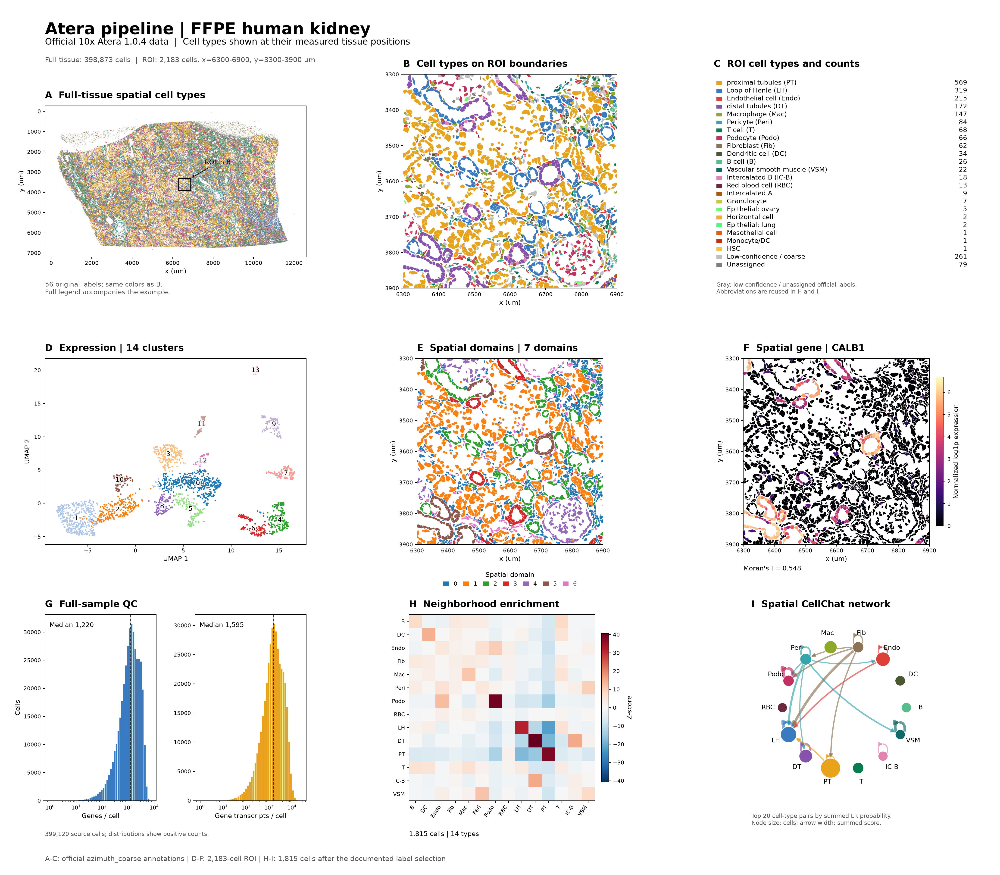

# Atera 空间单细胞分析

读取用户提供的 Atera 数据，沿用平台细胞分割，按下面的流程分析：

```text
加载+QC → 表达聚类+细胞注释 → 空间域+SVG → 邻域富集+细胞通讯
```

## 使用

```text
分析我的 Atera 数据，路径在 /data/my_atera/，每个阶段展示空间图和结果，停下来给我审查。
```

输入可以是样本输出目录、`experiment.spatial`、`cell_feature_matrix.zarr.zip` / 解压后的 `.zarr`，或已有的细胞级 `.h5ad`。读取样本的物种、组织、面板、软件版本和注释字段；分析范围取用户提供的样本或指定区域，多样本按样本和 ROI 分别处理。

## 分析流程

1. **加载与质控**：调用 `visium_new_platforms.load_atera`。保存原始基因计数、控制信号、官方保留标记和微米坐标；报告细胞数、基因数与计数分布。原生 Zarr 中 `filtered=True` 表示官方保留，`centroid_column/row` 对应 x/y。有 `cells.zarr.zip` 时按完整 cell ID 核对分割与中心坐标，展示边界图。
2. **表达聚类与细胞注释**：调用 `normalize_visium`、`cluster_spatial_data`，完成总量归一化、log1p、PCA、近邻图、Leiden 和 UMAP。根据细胞数及基因覆盖设置参数；沿用数据中的注释及置信分数，或结合用户提供的参考完成标签映射。加载时通过 `cell_type_key` 选择实际注释字段，待注释数据设为 `None`。
3. **展示空间注释**：把细胞类型画在实际组织坐标上；有分割多边形时按细胞 ID 填色，有中心坐标时绘制细胞点。全样本与局部放大图共用颜色，列出标签和数量，低置信度及未分配标签用灰色表示。原生 Zarr 可调用 `atera.plot_atera_annotations`，显式传入样本标题、标签字段及分割路径。
4. **空间域与空间基因**：调用 `identify_spatial_domains`、`find_spatially_variable_genes`。结合表达与空间邻接识别区域，用 Moran's I 排序空间变异基因，展示域分布和基因空间表达。根据样本尺度、细胞密度与结果确定邻居数、空间权重和分辨率。
5. **邻域与通讯**：将原始计数、审查后的细胞标签和空间坐标交给 [共享下游](../spatial-downstream/SKILL.md)。Squidpy 计算邻域富集；CellChat 按样本物种选择数据库，空间模式使用微米尺度。明确实际距离参数和纳入的细胞群，展示富集热图及通讯网络。

## 输出与审查

结果保存到用户项目的 `results/`，文件名使用实际样本名。每阶段保留 h5ad、统计表、图片和参数；原始计数保存在 `layers['counts']`，注释保留原字段及来源。展示结果并解释后，等待 `通过` / `调整` / `跳过`，再进入下一阶段。

## Atera 示例组图

展示数据：[10x 官方 FFPE 人正常肾脏](https://www.10xgenomics.com/datasets/atera-wta-ffpe-human-nd-kidney)，Atera Onboard Analysis 1.0.4。全组织保留 398,873 个细胞；局部分析展示 2,183 个细胞，注释来自官方 `azimuth_coarse`。



A–C：空间细胞注释与局部图例；D–F：表达聚类、空间域和空间变异基因；G–I：质控、邻域富集和细胞通讯。示例数据、参数及复现入口见 [肾脏示例记录](references/kidney-example.md)。
